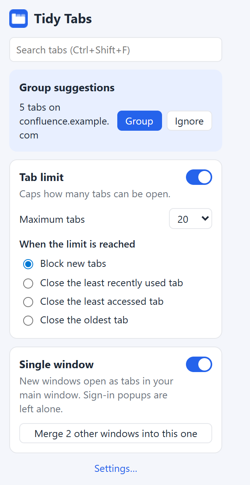
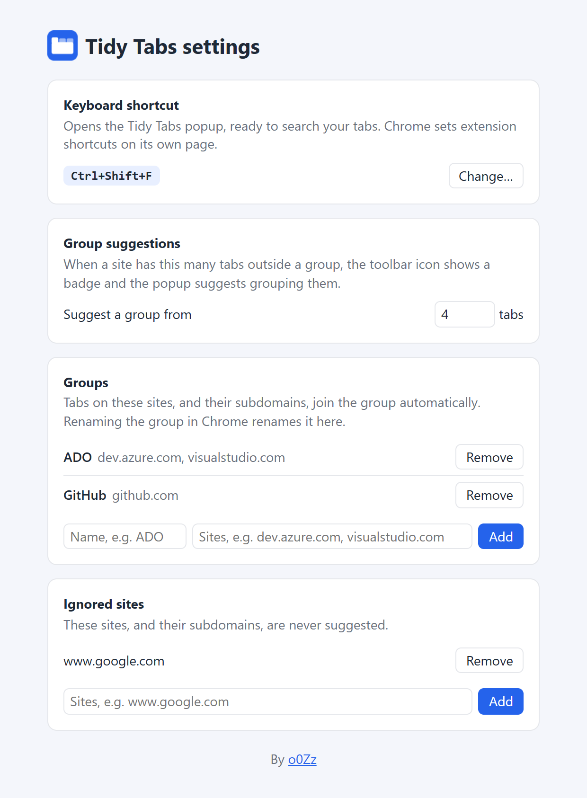

<div align="center">


# Tidy Tabs

**Fewer tabs. One window. Everything where you expect it.**

A lightweight Chrome extension that keeps your browser under control:
find any tab in a keystroke, cap the tab count, keep everything in one window
and let your tabs group themselves by site.

[**Download the latest release**](https://github.com/o0Zz/tidy-tabs/releases/latest) · [Privacy](PRIVACY.md) · [Report an issue](https://github.com/o0Zz/tidy-tabs/issues)

</div>

<p align="center">
  
  &nbsp;&nbsp;
  
</p>

## Why Tidy Tabs?

Forty tabs across five windows, three of them on the same ticket, and the one you need is nowhere to be found. Tidy Tabs fixes that without changing how you browse: it works quietly in the background and only steps in where it saves you time.

## Features

### 🔎 Find any tab in a keystroke
Press **Ctrl+Shift+F** and start typing. Tidy Tabs searches the title, address and group of every open tab, in every window, and narrows the list as you type. Press **Enter** to jump straight to the tab.

### 🧮 A tab limit that respects your work
Set a maximum (20 by default) and choose what happens when you reach it:

- **Block new tabs** (default): nothing you already have open is ever touched.
- **Close the least recently used**, **least accessed** or **oldest** tab to make room.

The close modes never touch the tab you are looking at, the tab you just left, pinned tabs or tabs playing sound. *Tip: pin the tabs where you write long text, Chrome does not warn about unsaved input.*

### 🪟 One window, always
New windows open as tabs in your main window, so nothing gets lost behind another window. Already have a pile of windows? One click on **Merge windows** brings them all into the current one, with their tab groups and pinned tabs intact. Sign-in popups (Microsoft, Google, …) are left alone, so logins keep working.

### 🗂️ Tab groups that build themselves
When a site reaches 4 tabs, the toolbar icon shows a badge and Tidy Tabs suggests a group. One click on **Group**, and that site's tabs, now and in the future, land in their own tab group.

Want more control? Create groups by hand in the settings, e.g. **ADO** = `dev.azure.com, visualstudio.com`. Subdomains are included, renaming a group in Chrome renames it in Tidy Tabs, and tabs you move yourself stay where you put them.

### 🔒 Private by design
No account, no analytics, no network requests, no access to page content. Tidy Tabs only reads the titles and addresses of your tabs, inside your browser. Details in the [privacy policy](PRIVACY.md).

## Install

1. Download `tidy-tabs-vX.Y.Z.zip` from the [latest release](https://github.com/o0Zz/tidy-tabs/releases/latest) and unzip it.
2. Open `chrome://extensions` and turn on **Developer mode** (top right).
3. Click **Load unpacked** and select the unzipped folder.
4. Pin Tidy Tabs to the toolbar (puzzle icon → pin) and you are done.

Built and tested for Google Chrome.

## FAQ

**Can Tidy Tabs close a tab I am typing in?**
Not by default: the default mode only blocks new tabs. The close modes never close the active tab, the tab you just left, pinned tabs or tabs playing sound.

**Will it break sign-in popups?**
No. Popup windows (OAuth, Microsoft / Azure login, Teams) are never merged, blocked or counted.

**Does it touch my incognito windows?**
Only if you allow the extension in incognito. Even then, incognito and normal windows are never merged together.

**Does it reduce memory use?**
Fewer tabs help, but Tidy Tabs limits tabs and windows, not memory. For RAM, also turn on `chrome://settings/performance` → **Memory Saver**, and add the sites where you write long text (e.g. `dev.azure.com`) to **Always keep these sites active**.

**Where are my settings stored?**
In Chrome's own storage. With Chrome sync turned on, they follow you across your devices.

## For developers

Plain JavaScript, Manifest V3, no build step and no runtime dependencies. The extension lives in [`src/`](src).

```
npm install
npm test
```

The tests launch Chrome for Testing with the extension loaded and check real tabs, windows and groups.

**Release:** push a tag, e.g. `git tag v1.2.0 && git push origin v1.2.0`. The GitHub workflow sets the manifest version from the tag (`src/manifest.json` stays at `0.0.0` in the repo), runs the tests and attaches `tidy-tabs-v1.2.0.zip` to a GitHub release.

---

<p align="center">Made by <a href="https://github.com/o0Zz">o0Zz</a></p>
